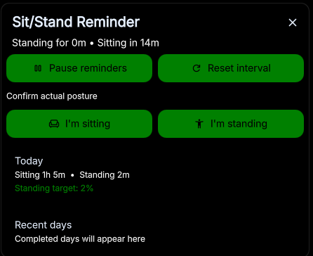

# Sit/Stand Reminder

[](https://ci.codeberg.org/repos/17672)

A lightweight DankMaterialShell plugin that reminds you to alternate between sitting and standing. Posture changes come from your confirmations, with sitting as the fresh-day fallback; keyboard and mouse activity are never treated as posture detection.

The canonical repository is hosted on [Codeberg](https://codeberg.org/knappancash/SitStandReminder). The [GitHub repository](https://github.com/knappancash/SitStandReminder) is a mirror.



## Features

- Configurable sitting and standing intervals
- Persistent transition notifications, with actions and one configurable snooze option when supported
- A distinct transition sound using DMS sound settings
- Idle-aware timer pausing
- 30 days of tracked sitting and standing totals
- Automatic reminder cutoff after reaching the daily standing target
- Shared state across every bar and monitor

## Installation

Install and enable **Sit/Stand Reminder** from the DMS Plugins page, then add its widget to DankBar or the Control Center.

For local development, link this checkout and rescan plugins:

```sh
mkdir -p ~/.config/DankMaterialShell/plugins
ln -s "$PWD" ~/.config/DankMaterialShell/plugins/sitStandReminder
dms ipc call plugin-scan scan
```

Requires DMS 1.5 or newer and `notify-send` from `libnotify`.

## How to use it

1. Open the widget and confirm whether you are sitting or standing.
2. When a transition notification appears, change posture and confirm it from the notification or widget.
3. The notification stays visible until you confirm, snooze, or close it. Closing it leaves the transition overdue.
4. Pause reminders when you do not want them. Enabling them again resumes the same posture and interval where they stopped; after the configured staleness limit, it asks for your posture again.

On startup, today's saved posture is restored. If no posture has been recorded for the current day, the plugin starts with sitting.

The defaults are 30 minutes sitting, 15 minutes standing, and a 10-minute snooze. They are starting points rather than medical guidance; adjust them to what feels comfortable.

## Settings

The plugin settings let you change:

- Sitting, standing, and snooze durations
- Notification repeats and return grace period
- Idle detection and whether idle time counts toward today's totals
- The daily standing target
- When the next statistics day starts, up to 12 hours after midnight
- Session, daily-statistics, and full-state resets

## Optional IPC

These commands are useful for compositor keybindings:

```sh
dms ipc call sitStandReminder toggle
dms ipc call sitStandReminder sit
dms ipc call sitStandReminder stand
dms ipc call sitStandReminder snooze 10
dms ipc call sitStandReminder reset
dms ipc call sitStandReminder status
dms ipc call sitStandReminder history
```

The popout shows today plus the seven most recent completed days by default; selecting the graph cycles through 14 and 30 days. `history` returns all retained completed days as JSON. Only daily totals are stored; there is no event or activity log.

Apart from the fresh-day sitting fallback, posture changes require explicit confirmation. Notification actions require support from the active notification server; the widget controls continue to work without them.
